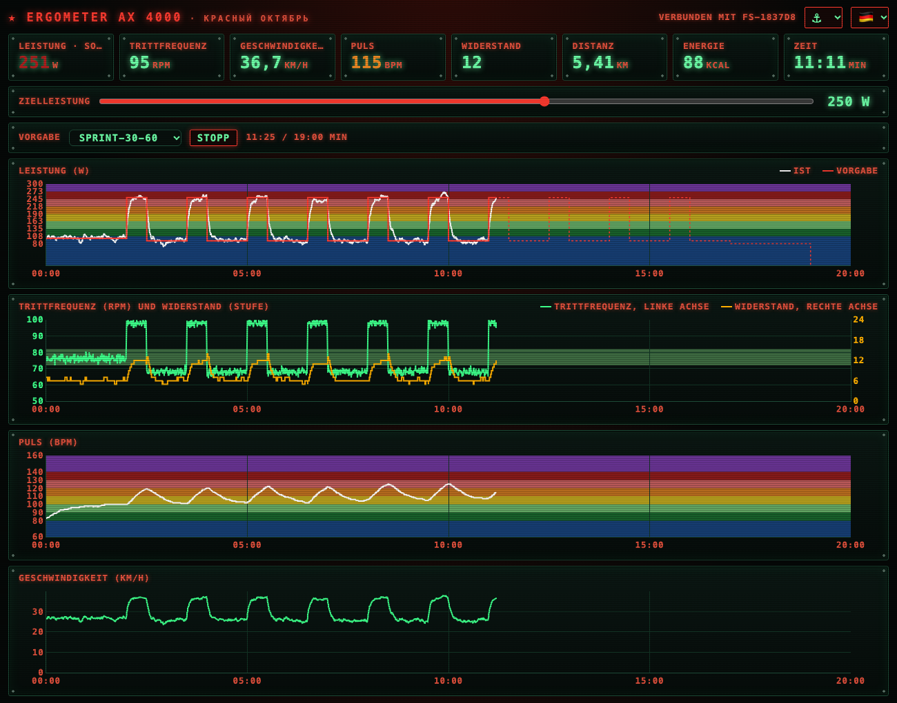
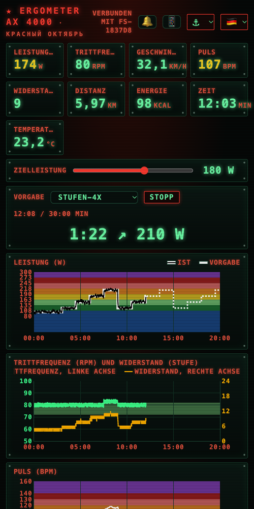

# Ergometer

Verbindet sich per Bluetooth LE mit einem Christopeit AX 4000 Ergometer, zeigt die Messwerte live an und regelt auf Wunsch eine Zielleistung.

- Messwerte in der Konsole: Geschwindigkeit, Trittfrequenz, Leistung, Widerstand, Distanz, Energie, Puls, Zeit
- Cockpit im Browser mit Kacheln und Plotly-Verlaufskurven
- Zielleistung in Watt: das Programm stellt dazu die Widerstandsstufe des Ergometers nach der Watt-Tabelle ein
- Leistungsvorgaben aus Dateien (Intervalle, Stufentest) und Aufzeichnung jeder Fahrt als CSV
- Handy als Fernbedienung: QR-Code scannen, dann Vorgabe, Start und Stopp am Ergometer bedienen
- Auswertung: Stufentest gegen Referenzdaten, Bericht je Fahrt und ein Kalender aller Einheiten, nach Intensität gefärbt



*Das Cockpit am Rechner während der Vorgabe `stufen-4x`, oben der QR-Code für das Handy. Die Messwerte in den Bildern sind simuliert.*



*Dasselbe Cockpit auf dem Handy: Vorgabe wählen, Start und Stopp, darunter groß der Countdown bis zum nächsten Leistungswechsel.*

## Installation

Voraussetzungen:

- ein Mac mit Bluetooth in Reichweite des Ergometers (wenige Meter)
- [uv](https://docs.astral.sh/uv/) – es besorgt Python und die einzige Abhängigkeit `bleak` beim ersten Start von selbst
- Internetverbindung für das Cockpit, am Mac wie am Handy (Plotly wird von einem CDN geladen)
- für die Fernbedienung: ein Handy im selben WLAN wie der Mac

Einmalig einrichten:

1. uv installieren, falls es fehlt:

   ```
   brew install uv
   ```

   Ohne Homebrew: `curl -LsSf https://astral.sh/uv/install.sh | sh`

2. Das Programm holen:

   ```
   git clone https://github.com/HelmutQualtinger/Ergometer.git ~/Ergometer
   ```

3. Prüfen, ob der Mac das Ergometer sieht. Dazu ein paar Umdrehungen treten, damit es aufwacht, dann:

   ```
   cd ~/Ergometer
   uv run ergometer.py --scan
   ```

   Beim ersten Mal fragt macOS, ob das Terminal Bluetooth verwenden darf – erlauben. Wurde die Frage abgelehnt, lässt sich das unter Systemeinstellungen → Datenschutz & Sicherheit → Bluetooth nachholen. In der Liste erscheint das Ergometer unter dem Namen seines FitShow-Moduls, z. B. `FS-1837D8`.

Mehr ist nicht zu installieren: kein Build-Schritt, und auf dem Handy keine App – es benutzt seinen Browser (siehe [Handy als Fernbedienung](#handy-als-fernbedienung)).

## Starten

```
cd ~/Ergometer
uv run ergometer.py --panel
```

Das Programm sucht das Ergometer, verbindet sich und öffnet das Cockpit unter http://127.0.0.1:8050/. Im Terminal stehen dazu die Adresse für das Handy und ihr QR-Code. Beenden mit Ctrl+C; eine laufende Aufzeichnung wird dabei gespeichert.

Das Ergometer nimmt nur eine Bluetooth-Verbindung gleichzeitig an: Vor dem Start andere Apps (z. B. Kinomap) trennen und ein paar Umdrehungen treten, damit es aufwacht. Findet das Programm das Ergometer beim Start nicht, sucht es alle 30 Sekunden erneut, bis es da ist; das Cockpit läuft in der Zeit schon. Aus demselben Grund kann das Programm nur einmal laufen; ein zweiter Start scheitert mit `Address already in use`.

## C-Version

`ergometer.c` ist dasselbe Programm in C: gleiche Optionen, dasselbe Cockpit (`panel.html`), dieselben Vorgaben und Logdateien. Es braucht weder uv noch Python, dafür die Xcode Command Line Tools (`xcode-select --install`) und OpenSSL (`brew install openssl@3`, für HTTPS am Handy) zum Übersetzen:

```
cd ~/Ergometer
make
./ergometer --panel
```

Bluetooth läuft über CoreBluetooth und steckt in `ble_macos.m` (Objective-C, weil macOS dafür keine C-Schnittstelle hat); die C-Version läuft deshalb nur auf dem Mac. Wie die Python-Version beendet sie sich nicht, wenn das Ergometer abgeschaltet wird: Beide speichern eine laufende Aufzeichnung, melden „Ergometer disconnected“ und verbinden sich von selbst wieder, sobald es zurück ist. Nur die C-Version merkt außerdem, wenn das Ergometer nach einer Pause einschläft, ohne die Verbindung zu trennen. Es kann immer nur eines der beiden Programme laufen – das Ergometer nimmt eine Verbindung an, und beide benutzen Port 8050.

## Optionen

| Option | Bedeutung |
|---|---|
| `--panel` | Cockpit im Browser anzeigen |
| `--port N` | Port für das Cockpit (Standard: 8050) |
| `--power W` | Zielleistung in Watt schon beim Start vorgeben |
| `--profile DATEI` | Leistungsvorgabe aus einer Datei laden; sie startet, sobald das Ergometer verbunden ist |
| `--scan` | nur die Bluetooth-Geräte in der Nähe auflisten |
| `--name TEXT` | Gerät mit diesem Namensbestandteil suchen |
| `--address ID` | mit einem bestimmten Gerät verbinden (auf macOS eine UUID) |
| `--timeout S` | Suchdauer in Sekunden (Standard: 10) |
| `--raw` | zusätzlich die Rohdaten aller übrigen Benachrichtigungen ausgeben |

Ohne `--panel` gibt es nur die Konsolenausgabe.

## Cockpit

- Kacheln mit den aktuellen Werten, darunter Verlaufskurven für Leistung, Trittfrequenz, Geschwindigkeit und Puls über die letzten 20 Minuten
- Die Pulskurve liegt auf farbigen Zonen von 60 bis 160 bpm, die Leistungskurve auf denselben acht Farben, gleichmäßig verteilt von 80 bis 300 W. Die Kacheln für Puls und Leistung zeigen ihren Wert in der Farbe der aktuellen Zone.
- Fällt der Puls unter 80 bpm, hat der Brustgurt meist den Kontakt verloren: Die Kurve überbrückt solche Lücken mit einer geraden Linie (Grenze `PULSE_FLOOR` in `panel.html`). Die Kachel zeigt weiter den gemeldeten Wert, und die Aufzeichnung enthält alle Werte.
- Im Leistungsdiagramm ist die Vorgabe eine fette weiße Linie, die gemessene Leistung liegt schwarz darüber.
- Die Kachel „Temperatur" zeigt die Raumtemperatur. Das Programm liest sie per MQTT von einem Sensor. Adresse und Topic des Brokers stehen in der Datei `.env` neben dem Programm (`MQTT_HOST`, `MQTT_PORT`, `MQTT_TOPIC`); sie gehört nicht ins Repository. Als Vorlage dient `.env.example`: kopieren (`cp .env.example .env`) und ausfüllen. Fehlt `MQTT_HOST` oder `MQTT_PORT`, entfällt die Kachel. Feld und Korrektur stehen als Konstanten `MQTT_FIELD` und `MQTT_OFFSET` oben in `ergometer.py`.
- Oben rechts lassen sich Erscheinungsbild und Sprache umschalten.
- Solange das Programm läuft, bleiben Bildschirmschoner und Ruhezustand des Macs aus (`caffeinate`).

## Handy als Fernbedienung

Der Mac steht meist nicht in Griffweite des Sattels. Das Handy am Lenker zeigt deshalb dasselbe Cockpit in seinem Browser: Vorgabe wählen, Start, Stopp und Zielleistung lassen sich direkt am Ergometer bedienen. Eine App ist dafür nicht nötig. Das Handy spricht nur mit dem Programm auf dem Mac; die Bluetooth-Verbindung zum Ergometer hält weiterhin der Mac.

### Einrichten (einmalig)

1. Das Handy ins selbe WLAN bringen wie den Mac.
2. Am Mac das Programm mit `--panel` starten. Fragt die macOS-Firewall nach eingehenden Verbindungen, „Erlauben" wählen.
3. Den QR-Code mit der Kamera des Handys scannen. Er steht im Terminal und im Cockpit am Mac; der Knopf 📱 oben rechts blendet ihn dort ein und aus. Ohne Kamera geht es auch von Hand: Die Adresse steht im Terminal in der Zeile `Phone:` und im Cockpit neben dem QR-Code.
4. Das Zertifikat installieren (einmalig, damit das Handy der sicheren Adresse vertraut). Das Cockpit am Mac zeigt unter dem QR-Code die Adresse dazu, z. B. `http://192.168.1.48:8050/ca.crt`; sie steht auch im Terminal in der Zeile `Certificate for the phone`. Diese Adresse am Handy öffnen, dann:
   - Android: Die Datei wird geladen. Einstellungen → Sicherheit und Datenschutz → Weitere Sicherheitseinstellungen → Verschlüsselung und Anmeldedaten → Zertifikat installieren → CA-Zertifikat, dann `ca.crt` aus den Downloads wählen (die Menünamen weichen je nach Hersteller etwas ab).
   - iPhone: In Safari öffnen und „Zulassen" tippen. Einstellungen → Allgemein → VPN und Geräteverwaltung → Profil „Ergometer …" → Installieren. Danach Einstellungen → Allgemein → Info → Zertifikatsvertrauenseinstellungen → „Ergometer …" einschalten.
5. Den QR-Code noch einmal scannen. Jetzt öffnet sich das Cockpit über `https://…:8051/` ohne Warnung.
6. Das Cockpit als App installieren: Android/Chrome: Menü ⋮ → „App installieren"; iPhone: Teilen → „Zum Home-Bildschirm". Es erscheint mit eigenem Symbol und dem Namen „Ergometer" und öffnet sich ohne Adressleiste. Am iPhone merkt sich die App Erscheinungsbild und Sprache getrennt von Safari.
7. Die Bildschirmsperre des Handys für die Fahrt verlängern oder abschalten (iPhone: Einstellungen → Anzeige & Helligkeit → Automatische Sperre). Das Cockpit hält den Bildschirm des Handys nicht selbst wach.

### Im Betrieb

- Zuerst das Programm am Mac starten, dann das Cockpit am Handy öffnen. Läuft das Programm nicht, bleibt die Seite am Handy leer.
- Mac und Handy zeigen denselben Stand und lassen sich gleichzeitig bedienen: Was am Handy gestartet wird, läuft auch am Mac, und umgekehrt. Die Seite kann am Handy jederzeit geschlossen und neu geöffnet werden; die Fahrt und ihre Kurven bleiben erhalten, denn sie liegen im Programm.
- Am Handy rückt der Countdown bis zum nächsten Leistungswechsel in eine eigene Zeile und wird groß genug, um ihn vom Sattel aus zu lesen.
- Für die Pieptöne am Handy die Seite einmal antippen (z. B. den Knopf 🔔); vorher spielt der Browser keinen Ton. Am iPhone muss außerdem der Stummschalter aus sein.
- Erscheinungsbild, Sprache, Ton und die Anzeige des QR-Codes merkt sich jedes Gerät für sich. Beides lässt sich auch in der Adresse festlegen, z. B. `http://192.168.1.184:8050/?theme=dark&language=en`.
- Wird die Adresse in einem Messenger geteilt, zeigt er eine Vorschau mit Bild (`web/preview.png`), sofern der Empfänger im selben Netz ist.
- Der Mac muss wach bleiben: Das Programm verhindert den Ruhezustand, solange es läuft, aber ein zugeklapptes MacBook schläft trotzdem ein.

### Wenn das Handy das Cockpit nicht öffnet

| Anzeichen | Ursache und Abhilfe |
|---|---|
| Seite lädt nicht | Das Handy ist nicht im selben WLAN (Mobilfunk, Gastnetz) – ins Heimnetz wechseln. Viele Gastnetze trennen die Geräte voneinander. |
| Seite lädt nicht, WLAN stimmt | Die macOS-Firewall blockt: Systemeinstellungen → Netzwerk → Firewall → Optionen, dort eingehende Verbindungen für Python erlauben. |
| Lesezeichen geht nicht mehr | Der Mac hat vom Router eine neue Adresse bekommen. Das Cockpit am Mac zeigt sie ohne Neustart: Der QR-Code wird beim Einblenden und alle 10 Sekunden neu geprüft. Neu scannen; dauerhaft hilft eine feste Adresse für den Mac im Router (DHCP-Reservierung) und am Mac „Private WLAN-Adresse“ auf „Fest“ oder „Aus“. |
| QR-Code zeigt `127.0.0.1` | Der Mac hat gerade kein Netz. WLAN verbinden; der QR-Code passt sich nach spätestens 10 Sekunden an. |
| QR-Code zeigt eine fremde Adresse | Ein VPN am Mac ist aktiv. VPN trennen; der QR-Code passt sich nach spätestens 10 Sekunden an. |
| Warnung „Verbindung nicht privat“ | Das Zertifikat ist am Handy nicht installiert oder (iPhone) nicht in den Zertifikatsvertrauenseinstellungen eingeschaltet, siehe Einrichten, Schritt 4. Wurde `certs/` am Mac gelöscht, ist eine neue Zertifizierungsstelle entstanden: die alte am Handy entfernen und die neue installieren. |
| Kacheln da, Diagramme fehlen | Das Handy hat kein Internet; Plotly kommt von einem CDN. |
| „Start“ gedrückt, aber die Werte stehen still | Das Ergometer ist nach einer Pause eingeschlafen und sendet nicht mehr; die Python-Version zeigt trotzdem „Connected“ und zeichnet nichts auf. Programm beenden, ein paar Umdrehungen treten und neu starten (die C-Version verbindet sich von selbst wieder). |

### Sicherheit

- Der QR-Code enthält nur die Adresse des Cockpits im Heimnetz (z. B. `https://192.168.1.184:8051/`). Mit `--port N` ändert sich die Adresse entsprechend.
- Es gibt keine Anmeldung: Jedes Gerät im selben Netz kann das Cockpit öffnen und das Ergometer bedienen.
- Das Handy benutzt HTTPS auf dem Port nach dem des Cockpits (Standard 8051), der Mac weiter `http://127.0.0.1:8050/`. Das Zertifikat stellt das Programm selbst aus (`certificate.sh`, braucht `openssl`): beim ersten Start eine eigene Zertifizierungsstelle, die in `certs/` liegt und auf dem Handy installiert wird, und für jede neue Adresse des Macs ein neues Serverzertifikat. Das Handy muss danach nichts neu installieren.
- Die Zertifizierungsstelle darf nur Adressen im Heimnetz (10.x, 172.16–31.x, 192.168.x, 127.x und `localhost`) bestätigen. Wer `certs/ca.key` vom Mac kopiert, kann damit also keine fremden Webseiten auf dem Handy vortäuschen. `certs/` gehört trotzdem niemandem gegeben und steht nicht im Repository.
- Fehlt `openssl` oder scheitert das Zertifikat, läuft alles wie zuvor über unverschlüsseltes HTTP; das Cockpit lässt sich dann am Handy nur als Lesezeichen, nicht als App ablegen.

## Leistungsvorgabe aus einer Datei

Das Menü „Vorgabe" im Cockpit bietet alle Dateien `vorgabe-<name>.csv` an, die im Ordner `profiles` neben dem Programm liegen; neue Dateien erscheinen dort von selbst. „Start" beginnt das Profil, „Stopp" beendet es und schaltet die Regelung aus. Steht das Menü auf „manuell", beginnt „Start" eine Fahrt mit der Leistung, die der Schieber „Zielleistung" zeigt; der Schieber lässt sich während der Fahrt verstellen, ohne sie zu beenden. Während das Profil läuft, zeigt das Leistungsdiagramm die kommenden zwei Minuten als gepunktete weiße Linie. Rechts neben „Stopp" läuft ein Countdown bis zum nächsten Leistungswechsel, mit dem Wert, auf den es geht (z. B. „0:42 ↗ 150 W"). In den letzten 10 Sekunden piept es einmal pro Sekunde, beim Wechsel selbst einmal länger und höher. Der Knopf 🔔 oben rechts schaltet den Ton aus und ein; ein Browser spielt Ton erst, nachdem die Seite einmal angetippt oder angeklickt wurde. Wer den Schieber „Zielleistung" bewegt, übernimmt von Hand und hält das Profil an.

Die Datei hat zwei Spalten, Zeit (`mm:ss`) und Watt, getrennt durch Komma, Semikolon oder Tabulator. Jede Zeile gilt ab ihrer Zeit bis zur nächsten; eine letzte Zeile mit 0 Watt beendet das Profil. Eine Kopfzeile ist erlaubt.

```
zeit,watt
00:00,80
02:00,200
02:15,100
25:00,0
```

Mitgeliefert sind elf Profile:

- `vorgabe-hit.csv` (25 Minuten): 21 Zyklen aus 15 Sekunden bei 200 W und 45 Sekunden bei 100 W, davor und danach 2 Minuten bei 80 W
- `vorgabe-hiit-20.csv` (20 Minuten): 12 Runden aus 30 Sekunden bei 230 W und 30 Sekunden bei 80 W, davor 4 Minuten bei 100 W, danach 4 Minuten bei 80 W
- `vorgabe-intervall-1-3.csv` (24 Minuten): 5 Zyklen aus 1 Minute bei 200 W und 3 Minuten bei 100 W, davor und danach 2 Minuten bei 80 W
- `vorgabe-sprint-30-60.csv` (19 Minuten): 10 Zyklen aus 30 Sekunden bei 250 W und 60 Sekunden bei 90 W, davor 2 Minuten bei 100 W, danach 2 Minuten bei 80 W
- `vorgabe-sprint-20-40.csv` (24 Minuten): 4 Blöcke aus je 4 Zyklen mit 20 Sekunden bei 250 W und 40 Sekunden bei 125 W, nach jedem Block 1 Minute bei 100 W, davor 2 Minuten bei 100 W, danach 2 Minuten bei 80 W
- `vorgabe-roennestad-30-15.csv` (32:30 Minuten): Mikrointervalle nach Rønnestad, 2 Serien aus je 13 Zyklen mit 30 Sekunden bei 240 W und 15 Sekunden bei 120 W (120 % und 60 % einer FTP von 200 W), dazwischen 3 Minuten bei 100 W, davor 4 Minuten bei 100 W und 2 Minuten bei 150 W, danach 4:30 Minuten bei 80 W
- `vorgabe-persoenlich-30.csv` (30 Minuten): 3 Blöcke von 5 Minuten bei 200 W mit 2 Minuten bei 120 W dazwischen, 6 Minuten Einfahren in drei Stufen, 5 Minuten Ausfahren; aus einem Stufentest abgeleitet (85 % von 236 W)
- `vorgabe-schwelle-3x8.csv` (45 Minuten): 3 Blöcke von 8 Minuten bei 195, 195 und 200 W mit 3 Minuten bei 120 W dazwischen, 10 Minuten Einfahren (5 Minuten bei 120 W, 5 Minuten bei 140 W), 5 Minuten Ausfahren bei 110 W; Steigerung von `persoenlich-30` zur Vorbereitung auf 200 W über 30–40 Minuten
- `vorgabe-stufen-4x.csv` (30 Minuten): 4 Durchgänge mit stufenweisem Anstieg über 120, 150, 180 und 210 W (je 90 Sekunden), davor und danach 3 Minuten bei 100 W; aus einem Stufentest abgeleitet (51 bis 89 % von 236 W)
- `vorgabe-stufen-4x-230.csv` (30 Minuten): wie `stufen-4x`, die oberste Stufe aber bei 230 statt 210 W
- `vorgabe-stufentest.csv` (35 Minuten): ab 100 W alle 3 Minuten 25 W mehr, bis 350 W, danach 2 Minuten bei 80 W

## Aufzeichnung

Zwischen „Start" und „Stopp" werden alle Messwerte des Ergometers aufgezeichnet. Auch die Kurven im Cockpit laufen nur in dieser Zeit: Vor dem Start stehen die Diagramme bei 00:00 und nur die Kacheln zeigen die aktuellen Werte, nach dem Stopp bleiben die Kurven stehen. Beim Stopp – auch wenn das Profil von selbst endet, der Schieber übernimmt, die Verbindung abbricht oder das Programm beendet wird – entsteht daraus `logs/log-<jj-mm-tt-hh-mm-ss>.csv`, benannt nach dem Startzeitpunkt. Die Datei enthält je Messung eine Zeile mit Uhrzeit, Sekunden seit dem Start, Zielleistung und den gemeldeten Werten (Geschwindigkeit, Trittfrequenz, Widerstand, Leistung, Puls ...) sowie der Raumtemperatur, wenn der Sensor sie liefert.

## Stufentest auswerten

```
python3 stufentest.py --age 50 --weight 80 --betablocker
```

Das wertet die jüngste Aufzeichnung in `logs/` als Stufentest aus (oder eine als Argument genannte Datei) und schreibt daneben `stufentest-<jj-mm-tt-hh-mm-ss>.html` mit Plotly-Diagrammen:

- maximale Leistung und daraus geschätzte VO₂max
- Einordnung in die gemessenen Verteilungen von Männern desselben Alters, mit Quantilen: FRIEND-Register (USA, Kaminsky et al. 2022) und SHIP (Deutschland, Koch et al. 2009)
- Puls gegen Leistung mit Ausgleichsgerade, dazu Leistungs- und Pulsverlauf und die Stufentabelle

`--height` (cm) legt die BMI-Gruppe der deutschen Vergleichsdaten fest. `--betablocker` schaltet die Beurteilung des Pulses ab. `--pdf` schreibt zusätzlich ein kompaktes, zweispaltiges PDF im Hochformat (braucht Google Chrome). Die Vergleichsdaten gelten nur für Männer. In Claude Code erledigt der Skill `stufentest` dasselbe.

## Lauf ansehen und ablegen

```
python3 lauf.py                                   # jüngste Aufzeichnung
python3 lauf.py logs/log-A.csv logs/log-B.csv     # mehrere Aufzeichnungen als eine Fahrt
python3 lauf.py --training --note "HIIT 12x(30:30)" --rr 126/83/87
python3 lauf.py --training --unrecorded 25/250/110  # danach 25 min ohne Aufzeichnung (min/kcal/Puls vom Display)
```

Das schreibt neben die erste Datei `lauf-<jj-mm-tt-hh-mm-ss>.html`: Kennzahlen, Beobachtungen (z. B. Abschnitte, die über die Vorgabe schossen), Leistung, Puls und Trittfrequenz im Verlauf (Puls und Trittfrequenz als gleitendes Mittel), die mittlere Leistung jedes Abschnitts gegen seine Vorgabe und Tabellen dazu. Lücken zwischen mehreren Aufzeichnungen sind markiert. Mit `--assessment "…"` kommt oben eine Karte „Bewertung“ mit einem Absatz Text dazu; mehrmals angegeben ergibt es mehrere Absätze.

Mit `--training` wird die Fahrt zusätzlich in `~/training/training_log.csv` eingetragen, samt Distanz, Trittfrequenz, Spitzenleistung, Höchstgeschwindigkeit und Temperatur – also den Spalten, die sonst aus einer Kinomap-Zusammenfassung kommen. Eine Fahrt, die schon im Log steht, wird nicht doppelt eingetragen. Die Raumtemperatur steht in neueren Aufzeichnungen selbst; für ältere gibt es `--temperature`. In Claude Code erledigt der Skill `lauf` dasselbe.

## Kinomap-Fahrt ansehen

```
python3 kinomap.py ~/training/cern.zip --betablocker
```

`kinomap.py` liest den Export einer Kinomap-Aktivität (das Zip mit `.csv`, `.tcx`, `.gpx` und `.pwx`) und schreibt `logs/kinomap-<jj-mm-tt-hh-mm-ss>.html`: Kennzahlen samt Normalized Power, Beobachtungen, Leistung gegen die FTP, Puls, Trittfrequenz, Geschwindigkeit und Höhe im Verlauf, die mittlere Leistung je fünf Minuten, die beste mittlere Leistung je Dauer und die Zeit in den Intensitätsstufen des Kalenders. Eine solche Fahrt hat keine Vorgabe, deshalb fehlt der Vergleich von Ist und Soll. Ins Trainingslog trägt das Programm nichts ein; es zeigt nur die Zeile, die dort schon steht. `--ftp` ändert die Bezugsleistung (200 W). `--assessment "…"` fügt wie bei `lauf.py` eine Karte „Bewertung“ hinzu.

## Trainingskalender

```
python3 kalender.py            # schreibt logs/index.html
python3 kalender.py --ftp 210  # andere Bezugsleistung
```

`kalender.py` liest `~/training/training_log.csv` und zeigt alle Einheiten als Monatskalender. Die Farbe eines Tages steht für seine mittlere Leistung als Anteil der FTP (200 W, fünf Stufen von „unter 70 %" bis „ab 100 %", von Grün über Gelb, Orange und Rot bis Violett: Grün für leichte, Violett für harte Tage); die Knöpfe darüber färben stattdessen nach Kalorien oder Dauer. Eine kleine Zahl in der Ecke nennt die Zahl der Einheiten, wenn es an einem Tag mehrere waren. Ein Klick auf einen Tag zeigt seine Einheiten als Tabelle. Bei Einheiten, die mit diesem Programm aufgezeichnet wurden, führt die Spalte „Auswertung" zur Seite von `lauf.py` und, bei einem Stufentest, von `stufentest.py`, bei einer Kinomap-Fahrt zur Seite von `kinomap.py`; zugeordnet wird über Datum, Kalorien und Dauer. Die Seite ist eine Momentaufnahme: Nach einem neu abgelegten Lauf das Programm noch einmal aufrufen. Oben verweist ein Link auf die Trainingsübersicht `training.html` im Repo `training` (relativ, `../../training/training.html`: gilt lokal, wenn beide Repos nebeneinander liegen, und auf GitHub Pages); die Seiten von `lauf.py`, `stufentest.py` und `kinomap.py` verlinken oben auf den Kalender und die Trainingsübersicht. Zusätzlich schreibt das Programm `logs/pages.json` (Auswertungsseiten je Einheitennummer); daraus setzt `training.html` in der Tabelle neben jede ausgewertete Einheit Links auf ihre Seiten.

## Zielleistung und Regelung

Im Cockpit stellt der Schieber „Zielleistung" die gewünschte Leistung ein (0 = aus, bis 300 W). Solange keine Fahrt läuft, merkt er sich den Wert nur für den nächsten Start; geregelt wird erst ab „Start". Die Regelung läuft im Programm, nicht im Ergometer:

1. Einmal pro Sekunde bestimmt das Programm aus der Watt-Tabelle des Herstellers die Widerstandsstufe (1–24), die bei der aktuellen Trittfrequenz (Mittel der letzten zwei Sekunden) der Zielleistung am nächsten kommt.
2. Ändert sich die Vorgabe, wird diese Stufe sofort eingestellt.
3. Bei gleicher Vorgabe folgt die Stufe der Trittfrequenz: Wer schneller tritt, bekommt weniger Widerstand, und umgekehrt. Verstellt wird erst, wenn die Tabelle eine Stufe verlangt, die mindestens 0,75 Stufen von der aktuellen entfernt ist, und frühestens 2 Sekunden nach der letzten Änderung; sonst würde das Programm zwischen zwei Stufen pendeln. Eine Stufe entspricht etwa 15–20 W.
4. Unter 20 rpm bleibt die Stufe stehen, statt den Widerstand hochzudrehen.

Ein Regler, der die gemeldete Leistung mit dem Ziel vergleicht (früher ein PID-Regler), ist nicht nötig: Der AX 4000 misst die Leistung nicht, sondern meldet den Wert seiner Watt-Tabelle für Stufe und Trittfrequenz – in den Aufzeichnungen stimmt beides auf etwa ein Watt überein. Die angezeigten Watt sind deshalb so genau wie diese Tabelle, nicht genauer.

Das Ergometer bestätigt zwar auch eine direkte Watt-Vorgabe über Bluetooth, hält die Leistung dann aber nicht selbst; deshalb stellt das Programm die Stufen.

Die Abstimmung steht als Konstanten oben in `ergometer.py`:

| Konstante | Bedeutung |
|---|---|
| `WATT_TABLE` | Watt je Stufe und Trittfrequenz aus dem Handbuch des AX 4000 (20 bis 80 rpm; darüber wird hochgerechnet) |
| `LEVEL_HYSTERESIS` | Abstand in Stufen zwischen aktueller und verlangter Stufe, ab dem verstellt wird |
| `LEVEL_SETTLE` | Wartezeit in Sekunden nach einer Änderung, bevor bei gleicher Vorgabe erneut verstellt wird |
| `MIN_CADENCE` | Trittfrequenz, unter der die Stufe stehen bleibt |

## Technik

- Die Messwerte kommen über den Bluetooth-Standard FTMS (Fitness Machine Service, `0x1826`), Merkmal „Indoor Bike Data" (`0x2AD2`).
- Der Widerstand wird über den „Fitness Machine Control Point" (`0x2AD9`) gesetzt. Das AX 4000 landet dabei teils eine Stufe neben dem angeforderten Wert; das Programm liest die gemeldete Stufe zurück und korrigiert.
- Im AX 4000 steckt ein Bluetooth-Modul von FITSHOW (Modell `FS-BT-D2`, Software 1.2.7). Es meldet 24 Widerstandsstufen und als Leistungsbereich 10 bis 240 W; diese Angabe ist Byte für Byte dieselbe wie der Widerstandsbereich und keine echte Grenze. Es meldet auch „Zielleistung" als unterstützt, ignoriert sie aber – deshalb regelt das Programm selbst.
- Die Watt-Tabelle steht in der Montage- und Bedienungsanleitung (Bestell-Nr. 2007A, Seite 9), die der Hersteller auf der [Produktseite](https://www.christopeit-sport.com/ergometer-ax-4000/30-2007a) zum Herunterladen anbietet. Sie endet bei 80 U/min; eine höchste zulässige Trittfrequenz nennt die Anleitung nicht.
- `ergometer.py` enthält Bluetooth-Anbindung, Leistungsregelung und einen kleinen HTTP-Server; `panel.html` ist das Cockpit und holt die Daten jede Sekunde vom Server.
- Den QR-Code erzeugt das Programm selbst, ohne zusätzliche Bibliothek: Byte-Modus, Versionen 1–6, Fehlerkorrektur H (bis etwa 30 % beschädigte Daten bleiben lesbar). Die Stufe steht als `QR_LEVEL` oben in `ergometer.py` (L, M, Q oder H).
